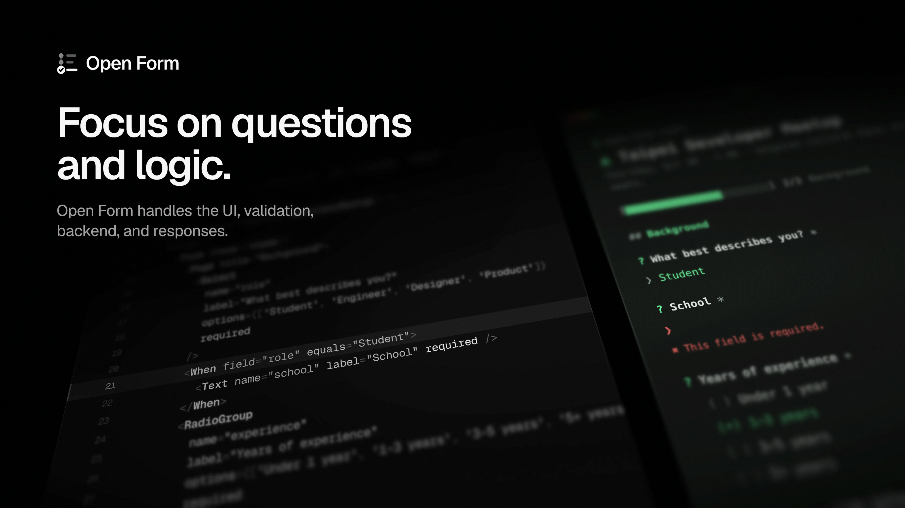

# Open Form

[](https://www.npmjs.com/package/@open-form-build/core)
[](https://github.com/ridemountainpig/open-form/actions/workflows/ci.yml)
[](LICENSE)

**Forms your agent writes. Responses you own.**

Open Form is an open-source form framework for coding agents. Describe the form to your agent: it writes one React file, and Open Form turns that file into a working form, checked in the browser and on the server, with a submission API, SQLite storage and a Studio for the answers.

[Website](https://open-form.build) · [Docs](https://open-form.build/docs) · [Live demo](https://demo.open-form.build) · [npm](https://www.npmjs.com/package/@open-form-build/core)

```
Questions + Logic  →  Production-ready Form  →  Responses
```

```bash
pnpm create open-form my-forms
cd my-forms
pnpm dev
```

Or `npm create open-form@latest my-forms`, then `npm run dev`. Requires Node.js 22.13+. Forms import from `@open-form-build/core`, and its CLI is `open-form`.

Then ask your coding agent (Claude Code, Codex, Cursor, …):

> Create a registration form for a developer meetup. Ask for name, email, role and experience. If they're a student, ask for their school. Limit the event to 100 registrations.

## Why

A coding agent can already write a form. It just rewrites the same hundreds of lines every time — state, validation, multi-step navigation, responsive CSS, an API route, a database schema, rate limiting, a responses page — and a little differently each time.

**Without Open Form** the agent generates: components, form state, validation, responsive CSS, step state, conditional rendering, API route, DB schema, queries, rate limiting, a responses page. *Hundreds of lines, different every time.*

**With Open Form** the agent generates:

```tsx
import { defineForm, Email, Form, Page, Select, Submit, Text, When } from '@open-form-build/core';

export const config = defineForm({
  title: 'Taipei Developer Meetup',
  submissions: { maxResponses: 100, uniqueBy: 'email' },
});

export default function Meetup() {
  return (
    <Form>
      <Page title="About you">
        <Text name="name" label="Name" required />
        <Email name="email" label="Email" required />
      </Page>
      <Page title="Background">
        <Select name="role" label="Role" options={['Student', 'Engineer', 'Designer']} required />
        <When field="role" equals="Student">
          <Text name="school" label="School" required />
        </When>
      </Page>
      <Submit>Register</Submit>
    </Form>
  );
}
```

…and gets a responsive multi-step form with progress, validation on both client and server, conditional questions, a 100-seat limit, one registration per email, spam protection, SQLite storage, a Responses dashboard and Excel / CSV export.

## What you get

- **Reusable runtime** — state, validation, multi-step flow, conditional logic, drafts, translations, focus management, loading / success / closed states.
- **The fields forms need** — text, email, URL, phone, number, date, choices, checkboxes, ratings, `<Matrix>` grids, and international phone numbers with a country picker.
- **Fully customizable** — it is React: themes via `defineTheme`, custom field components via `useField`.
- **Responsive and accessible by default** — labels, ARIA, keyboard, 16px inputs on mobile, dark mode, reduced motion.
- **Backend included** — `POST /api/forms/:id/submissions` with server validation, honeypot, signed timing token, rate limiting, submission windows, response limits, uniqueness and signed webhooks.
- **SQLite-first, zero infrastructure** — `node:sqlite`, no Docker, no database server, no API keys.
- **Studio** — forms list with folders; a live preview with Edit mode, where you change text in place or leave comments your agent applies; a responses table with filters, sorting and Excel / CSV / JSON export; schedule, response-limit and **Published** settings that take effect on a deployed server without a redeploy; a gallery of the reference themes. Turn on a public read-only Studio for demos.
- **Designed, not defaulted** — like open-slide, themes are references: five starters (`classic`, `editorial`, `terminal`, `brutalist`, `conversational`) and your own in `themes/` are what an agent reads to write each form its own look in `forms/<id>/theme/`, with only the tokens, CSS and components that form uses. Studio previews every theme, and **Adjust** fine-tunes a form's colors, fonts and shape.
- **Agent-native** — built-in skills (`create-form` proposes visual directions before writing, `create-theme` turns your design system into a theme, `form-authoring`, `current-form`, `apply-comments` turns notes left in Studio into edits) and a `current.json` cursor so "this form" means what you're looking at.
- **Deploy it your way** — `open-form start` on any Node host (guides for Docker and Railway), a route handler in your Next.js app, or a one-snippet embed on another site.
- **Repo owns the artifact, runtime data stays yours** — questions, logic and policy live in git; responses live in `.open-form/` and never do.

## Repo layout

| Path | Description |
| --- | --- |
| [packages/core](packages/core) | The framework: runtime, server, Studio, CLI, skills, template. |
| [packages/create-open-form](packages/create-open-form) | `npm create open-form@latest`: runs the core package's `open-form init`. |
| [packages/cli](packages/cli) | `npx @open-form-build/cli init`: runs the core package's `open-form` CLI. |
| [apps/demo](apps/demo) | Dogfood workspace with demo forms, each in its own look. |
| [apps/web](apps/web) | Website and docs (Next.js + Fumadocs). |
| [docs/ARCHITECTURE.md](docs/ARCHITECTURE.md) | Architecture and design decisions. |
| [docs/ROADMAP.md](docs/ROADMAP.md) | What's done and what's next. |

## Development

```bash
pnpm install
pnpm dev        # demo workspace → http://localhost:3000/studio
pnpm dev:web    # website + docs → http://localhost:3030
pnpm test
pnpm check
```

## License

MIT
