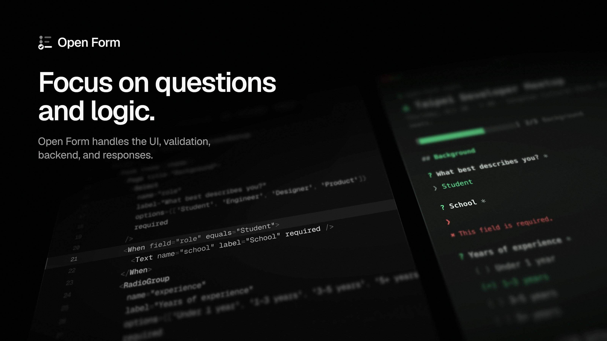

# @open-form-build/core

[](https://www.npmjs.com/package/@open-form-build/core)
[](https://github.com/ridemountainpig/open-form/actions/workflows/ci.yml)
[](https://github.com/ridemountainpig/open-form/blob/main/LICENSE)

**Forms your agent writes. Responses you own.**

Open Form is an open-source form framework for coding agents. Your agent writes one React file per form, and Open Form turns it into a working form, checked in the browser and on the server, with a submission API, SQLite or Postgres storage and a Studio for the answers.

[Website](https://open-form.build) · [Docs](https://open-form.build/docs) · [Live demo](https://demo.open-form.build) · [GitHub](https://github.com/ridemountainpig/open-form)

## Quick start

```bash
pnpm create open-form my-forms
cd my-forms
pnpm dev
```

Studio opens at `http://localhost:3000/studio`. `npm create open-form@latest my-forms` works too; then it's `npm run dev`. Requires Node.js 22.13+.

Then ask your coding agent (Claude Code, Codex, Cursor, …):

> Create a registration form for a developer meetup. Ask for name, email, role and experience. If they're a student, ask for their school. Limit the event to 100 registrations.

## A form

```tsx
// forms/meetup/index.tsx
import { defineForm, Email, Form, Page, Select, Submit, Text, When } from '@open-form-build/core';

export const config = defineForm({
  title: 'Taipei Developer Meetup',
  submissions: { maxResponses: 100, uniqueBy: 'email' },
});

export default function Meetup() {
  return (
    <Form>
      <Page title="About you">
        <Text name="name" label="Name" required />
        <Email name="email" label="Email" required />
      </Page>
      <Page title="Background">
        <Select name="role" label="Role" options={['Student', 'Engineer', 'Designer']} required />
        <When field="role" equals="Student">
          <Text name="school" label="School" required />
        </When>
      </Page>
      <Submit>Register</Submit>
    </Form>
  );
}
```

That file is a responsive multi-step form with progress, validation on both client and server, a conditional question, a 100-seat limit, one registration per email, spam protection, storage and a Responses dashboard.

## What you get

- **Runtime**: state, validation, multi-step pages, conditional logic, drafts, translations, focus management, loading, success and closed states.
- **Fields**: text, email, URL, phone, number, date, choices, checkboxes, ratings, `<Matrix>` grids and international phone numbers; your own fields with `useField`.
- **Backend**: `POST /api/forms/:id/submissions` with server validation, honeypot, signed timing token, rate limits, optional Cloudflare Turnstile, submission windows, response limits, uniqueness and signed webhooks.
- **Storage**: `node:sqlite` with nothing to set up, or [Postgres](https://open-form.build/docs/deploy/postgres) with one connection string.
- **Studio**: a live preview with Edit mode and comments your agent applies, a responses table with Excel / CSV / JSON export, and schedule, response-limit and Published settings that apply without a redeploy.
- **Themes**: each form gets its own look in `forms/<id>/theme/`; Studio previews the reference themes and **Adjust** fine-tunes colors, fonts and shape.
- **Agent skills**: `create-form`, `create-theme`, `form-authoring`, `current-form` and `apply-comments`, synced into `.agents/skills/`.

## Entry points

| Import | What |
| --- | --- |
| `@open-form-build/core` | DSL for forms: `Form`, `Page`, `When`, fields, `useField`, `defineForm`, `defineTheme`, `defineConfig`, `FormHost` |
| `@open-form-build/core/schema` | Framework-agnostic schema, conditions and validation |
| `@open-form-build/core/server` | Web-standard `(Request) => Response` handler and storage interface |
| `@open-form-build/core/sqlite` | `node:sqlite` storage adapter |
| `@open-form-build/core/postgres` | Postgres storage adapter (needs `pg`); used automatically when `OPEN_FORM_DATABASE_URL` is set |
| `@open-form-build/core/node` | Node HTTP adapter and production server |
| `@open-form-build/core/vite` | The Vite config and project helpers the CLI is built on (`createViteConfig`, `findForms`, `loadUserConfig`) |
| `@open-form-build/core/vercel` | A whole project as one Vercel Function (`createOpenFormApp`) |
| `@open-form-build/core/next` | Next.js route handlers (`createOpenFormRoute`) |
| `@open-form-build/core/styles.css` | Runtime styles, for rendering forms in your own React app with `<FormHost>` |
| `@open-form-build/core/env` | Types for images and CSS imported from forms; the workspace `tsconfig.json` loads it with `"types": ["@open-form-build/core/env"]` |

## CLI

| Command | What it does |
| --- | --- |
| [`init [dir]`](https://open-form.build/docs/cli/init) | Create a workspace (`--pm`, `--database`, `--vercel`, `--no-install`, `--no-git`) |
| [`dev`](https://open-form.build/docs/cli/dev) | Start the dev server with Studio |
| [`build`](https://open-form.build/docs/cli/build) | Build for production (`--server-only [--watch]` for Next.js) |
| [`start`](https://open-form.build/docs/cli/start) | Serve the production build: forms, API, storage |
| [`create <id>`](https://open-form.build/docs/cli/create) | Create a form from the starter |
| [`delete <id>`](https://open-form.build/docs/cli/delete) | Delete a form, its files and every response |
| [`list`](https://open-form.build/docs/cli/list) | List forms and their response counts |
| [`check [id]`](https://open-form.build/docs/cli/check) | Load forms like the server does and print their schema, or the error |
| [`responses export <id>`](https://open-form.build/docs/cli/responses-export) | Export responses as CSV, Excel or JSON |
| [`db status`](https://open-form.build/docs/cli/db) | Show which database stores responses, and check that it answers |
| [`db copy`](https://open-form.build/docs/cli/db#db-copy) | Copy the SQLite database into Postgres |
| [`theme check\|font`](https://open-form.build/docs/cli/theme) | Check a theme's contrast, download a Google Fonts family |
| [`comments [id]`](https://open-form.build/docs/cli/comments) | List review comments left in Studio |
| [`sync:skills`](https://open-form.build/docs/cli/sync-skills) | Update the agent skills in `.agents/skills/` |

Every command except `init` loads `.env` from the current folder when there is one; variables already set in the environment win.

## Environment variables

| Variable | Purpose |
| --- | --- |
| `OPEN_FORM_ADMIN_PASSWORD` | Enables Studio and the admin API in production (at least 16 characters) |
| `OPEN_FORM_DATABASE_URL` | Store responses in Postgres instead of SQLite |
| `OPEN_FORM_DB` | SQLite file path (default `.open-form/open-form.db`) |
| `OPEN_FORM_SECRET` | Signs timing tokens and Studio sessions; set it on serverless hosts, which can't write the generated `secret` file |
| `OPEN_FORM_WEBHOOK_SECRET` | Signs webhook deliveries |
| `OPEN_FORM_TURNSTILE_SECRET` | Verifies Cloudflare Turnstile tokens for forms with `protection.turnstile` |
| `OPEN_FORM_TRUST_PROXY` | Number of reverse proxies in front of the server (usually `1`) |

All of them, with defaults: [Production](https://open-form.build/docs/deploy/production#environment-variables).

## Deploy

| Where | How | Guide |
| --- | --- | --- |
| Any Node host | `open-form build`, then `open-form start` | [Production](https://open-form.build/docs/deploy/production) · [Docker](https://open-form.build/docs/deploy/docker) · [Railway](https://open-form.build/docs/deploy/railway) |
| Vercel | `open-form init --vercel`, or `createOpenFormApp()` from `@open-form-build/core/vercel` | [Vercel](https://open-form.build/docs/deploy/vercel) |
| Inside a Next.js app | `createOpenFormRoute()` from `@open-form-build/core/next`, forms rendered with `<FormHost>` | [Next.js](https://open-form.build/docs/deploy/nextjs) |
| Another website | A one-snippet embed | [Embed](https://open-form.build/docs/deploy/embed) |

Responses live in `.open-form/` (or your Postgres database) and never in git.

## License

MIT
